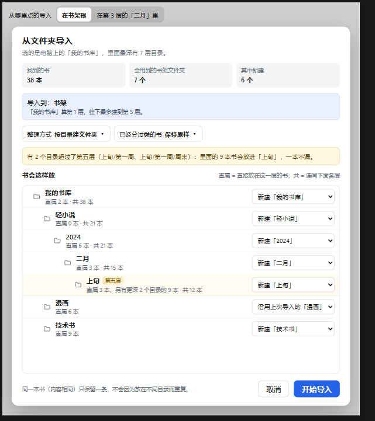
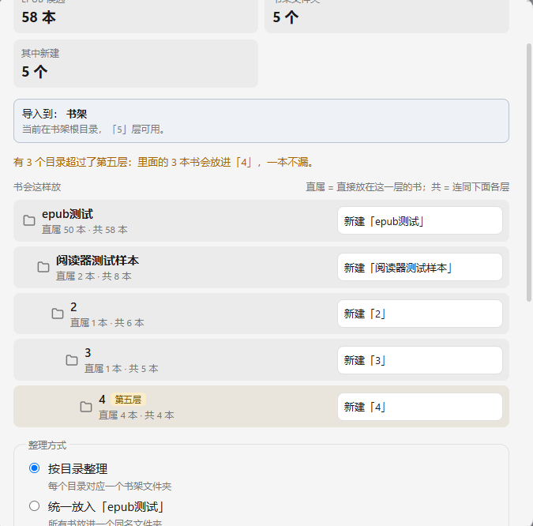

# A/B 实测：官方 DSH 对比插件包 + 调优预设（2026-11-10）

这次拿一个真实的前端任务，让官方原版 DSH 和"本插件包 + tuned 预设"各做一遍，比较三件事：耗时、花费、结果质量。只做了一对，n=1，结论只代表这一次。

## 任务与条件

- **任务：** 作者自己的桌面端 EPUB 阅读器里的一个前端包，内容是五层文件夹的书架导航、文件夹导入预览、移动文件夹。
- **输入：** 两边相同。起点是同一个提交，交接说明相同，四块 HTML 设计画板也相同。
- **代码：** 两边各用一份独立的 worktree，互相看不到对方的代码和会话。
- **模型：** 两边都是 `deepseek-flash`，推理档位 max，DSH 0.2.2-rc.1，都在新会话里跑。
- **对照组：** 官方默认配置，preset `standard`，不装第三方插件。
- **实验组：** 本仓库 v0.2.10，preset `tuned`。
- **偏差：**
  - 会话的工作区不在 worktree 里，所以每次写文件都要申请审批：调优版 34 次，官方版 17 次。跑到 7.9 分钟时两边都切到了自动审批。下表的时长都已扣掉审批等待。
  - 外部复核没有做盲审。

## 第一轮结果

数据取自 DSH 会话日志，只算第一轮，统计脚本见 [`scripts/ab/`](../../scripts/ab/)。

| 指标 | 调优版 | 官方版 | 差 |
|---|---|---|---|
| 时长 | 41.9 分 | 42.6 分 | 持平（< 10%） |
| 模型时间 / 工具时间 | 23.4 / 19.8 分 | 24.3 / 19.5 分 | 持平 |
| 步数 | 189 | 275 | **-31%** |
| 工具调用 | 264 | 282 | -6% |
| 一步里并行多个调用 | 55 步 | 8 步 | |
| 输入 token（含缓存读） | 5085 万 | 6432 万 | **-21%** |
| 输出 token | 16.8 万 | 16.0 万 | +5% |
| 缓存命中 | 99.5% | 99.6% | 持平 |
| 费用（官方闲时价） | $0.292 | $0.327 | **-10.6%** |

- **费用：** 按 DeepSeek 官方闲时价计算，每百万 token：缓存命中 $0.003，缓存未命中 $0.15，输出 $0.6。省下的钱全部来自少发的请求。缓存命中本来就很便宜，所以 token 少了 21%，钱只少了 10.6%。
- **上下文：** 调优版每次请求的上下文平均大 15%。但两边看过的文件内容总量几乎相同：调优版约 76.5 万字符，官方版约 73.9 万字符。差别在读的方式：调优版一开始就用 `read` 大段、并行地读进来，官方版用 `sed -n` 边改边一小段一小段地看。上下文更大和步数更少是同一件事的两面，所以 `read` 不需要加上限。

## 工具调用结构

| 指标 | 调优版 | 官方版 |
|---|---|---|
| 参数 JSON 解析失败 | 0 | 0 |
| 工具报错 | 1 次（沙箱拒绝） | 1 次（沙箱拒绝） |
| 原样重复的调用 | 6 次（反复看截图） | 0 |
| bash 拿来查看文件 | 50% | 63% |
| 后台任务 | dev server 放后台启动，用完停掉，结束前确认没有遗留 | 没有用后台 |

两边的调用结构都健康。这个任务里最长的命令只跑了 50 秒，wait-guard 截短了 43 次超时，但都没起作用；后台管理在这次也体现不出来。想验证这部分，需要挑有几分钟长命令的任务。

插件这一轮的动作：
- **progress-note：** 提醒了 13 次。7 次模型写了进展并接着干活，5 次只调了工具，1 次是最终总结。没有一次提前结束这一轮。
- **todo-reminder：** 提醒了 11 次，清单最后 9/9 完成。官方版最后也是 7/7。

## 结果质量

**逻辑：** 另一个模型按同一份清单复核了两边的逻辑边界。两边各有 1 个功能 bug，另有 1 到 2 处"预览之后目标被移动"的并发保护缺失。逻辑上差不多。

**设计还原：** 作者实际打开两个版本、嵌套到第 5 层查看，差距很明显。

| 设计画板 | 调优版 | 官方版 |
|---|---|---|
|  |  |  |

- **调优版：** 按画板重新排了面板，顺序是：统计 →"导入到"说明条 →"书会这样放"树（有文件夹图标、图例，每层显示"直属 · 共"）→ 整理方式。
- **官方版：** 保留了旧面板的结构，把文件夹树放在四组原有选项后面，没有图标。
- 两边读画板时都读全了，差距来自模型的实现选择。

作者的评价是："B 明显实现有问题……一个直接放到最后去了"，"图标正确的是 A（优化版本）"。

嵌套到第 5 层的对比，调优版在左，官方版在右：

| 调优版 | 官方版 |
|---|---|
|  |  |

调优版也有小差异：超过五层的提示只是一行文字，不是画板里的提示框；第五层没有单独写出"另有更深 N 个目录的 M 本"。

## 结论

- **耗时：** 持平。
- **花费：** 调优版少 10.6%，主要因为一步里并行多个调用，步数少了 31%。
- **质量：** 逻辑边界接近，设计还原调优版更好。
- **局限：** n=1，质量上的差距不能直接归因于插件。下一轮的要求：
  - 会话工作区直接设成 worktree，用同一个权限模式，全程不切换；
  - 验收清单事先写好，并包含"对照画板的结构还原"，评审做盲审；
  - 任务里至少有一个超过 2 分钟的命令；
  - 至少跑 3 对。

这次实验带来一处改动（v0.2.11）：命令转到后台后，模型常会立刻用 `job_output` 看一眼，多花一整步。wait-guard 现在会在转后台时告诉模型，结果会自动通知，先去做不依赖它的事。
