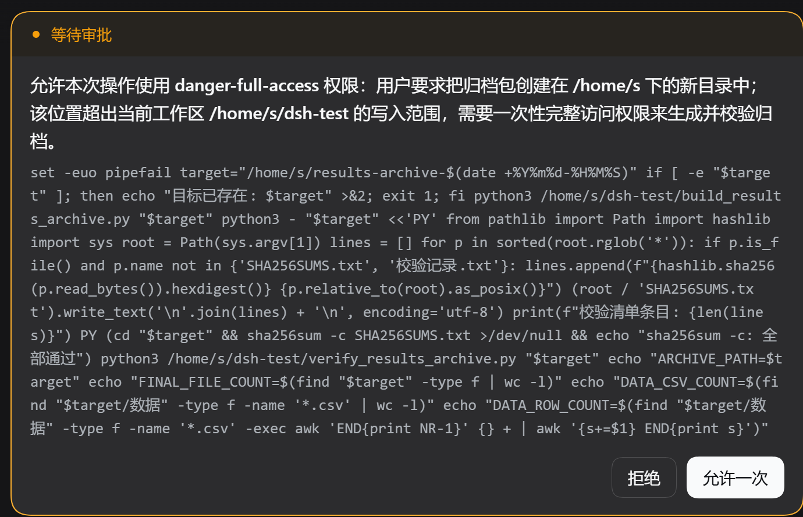
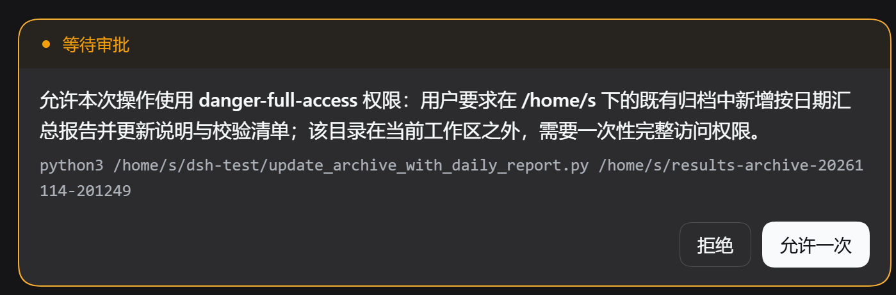

# 真实会话中的审批展示

用户只提出归档任务，未要求模型填写特定理由或故意省略字段。以下为 2026-11-14 两次独立运行的截图，均使用 DSH `0.2.2-rc.2`、`standard`、`deepseek-flash`（low）、工作区可写和询问审批策略。简洁展示为 `@herenfor/dsh-tune@0.2.17` 所含审批实现的发布前截图。

## 创建实验归档

任务：生成六组共六十份 CSV，每份一百条模拟观测，附统计、说明与 SHA-256 清单，并核对结果。

**审批增强开启**：Bash 命令 414 字符、11 行；模型自行填写 38 字符的原因。黄色等待条、完整访问权限的真实范围和原生按钮保留。

**原生审批展示**：同一任务需求的另一次独立运行，命令 1,065 字符、22 行，模型理由 81 字符。

## 追加日期汇总报告

两组都收到相同的后续请求：“请给刚才的归档增加一份按日期汇总的报告，并同步更新文件说明和校验清单，保留原始数据。”

**审批增强开启**：命令 483 字符、12 行，理由 37 字符。

**原生审批展示**：命令 100 字符、1 行，理由 65 字符。

## 验证结果与解读

- 截图与真实工具参数、`approval/asked` 和 `approval/decided` 记录逐项对应；六次审批均为允许一次，相关工具调用全部成功。
- 独立读取最终产物：两组各 60 份数据 CSV、6,000 条观测；SHA-256 清单分别 69/69、68/68 匹配。
- 原生展示组仍启用了 `wait-guard`，因此这是审批展示对比，不是纯官方与整套插件的性能实验。两次运行的命令和步骤不同，不能用审批次数、截图大小推导整体耗时、成本或调用数收益。
- 本组未自然出现理由缺失或超长理由。格式回退、取消、never 等边界另由执行对照及集成测试覆盖，不能用本页图片宣称全部手动验收。

公开图片只包含模拟归档任务与测试路径，未包含原始会话文件或认证信息。原始会话和协作记录不随仓库或 npm 包分发。完整验证范围见 [visual-verification.md](visual-verification.md)。
